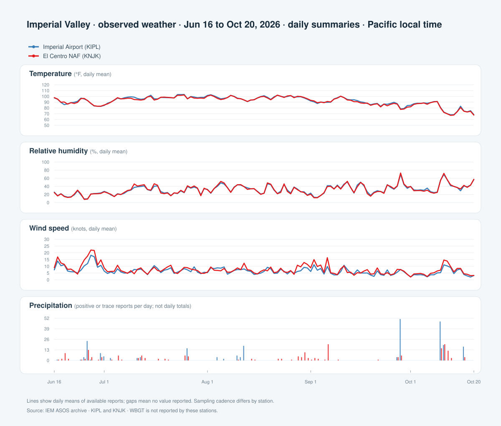

# Imperial Valley Weather

Observed ASOS data for Imperial Airport (KIPL) and El Centro NAF (KNJK), plus the west-side Calipatria/Westmorland feeds when available.

- `observations.csv`: station observations in Pacific local time.
- `weather-summary.svg`: daily means and precipitation report counts.
- `fetch_observations_heb.py`: refresh the east-side CSV with `python3 fetch_observations_heb.py`.
- `fetch_observations_wm_cal.py`: refresh the west-side Calipatria/Westmorland feed with `python3 fetch_observations_wm_cal.py`.

Blank values were not reported. Precipitation markers count positive or trace reports, not daily totals. WBGT is not reported by these stations. The west-side fetch accepts the CIMS, CAR, and Brawley signals and merges any valid records into the shared CSV without failing when one source is unavailable.
